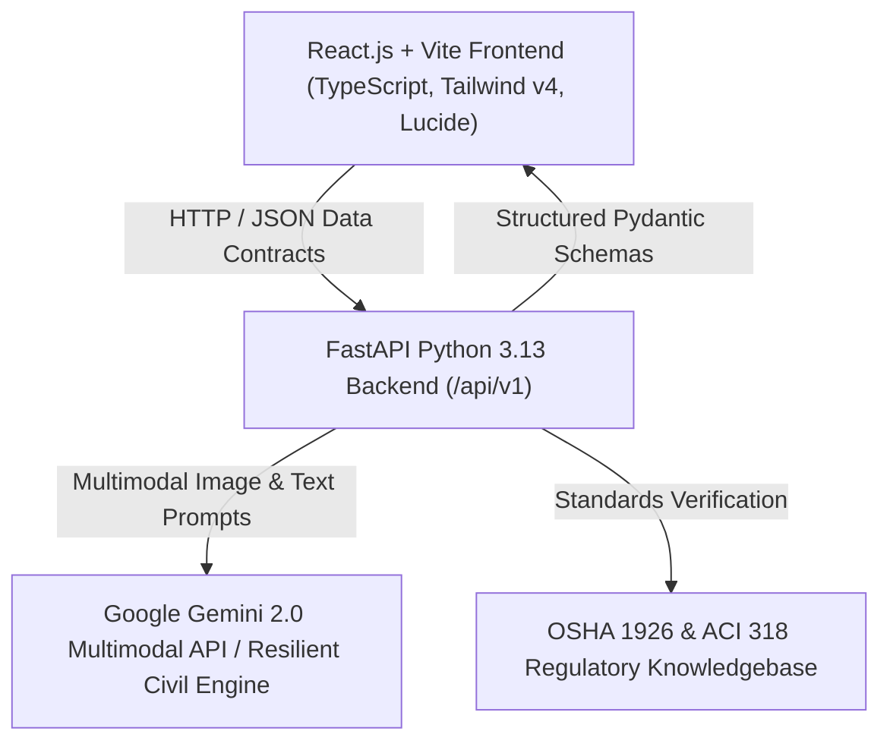

# Multimodal Construction Intelligence Platform

An intelligent, full-stack decision-support system designed to assist construction professionals across planning, execution, and monitoring. The platform leverages multimodal artificial intelligence (analyzing textual inputs, drone/site imagery, and structured project data) to generate accurate, actionable, and context-aware civil engineering insights.

---

## 🌟 Key Highlights & Capabilities

1. **Construction Site Safety Monitoring (Vision AI)**
   - Automatic detection of PPE compliance (hardhats, high-visibility vests, eye/ear protection, fall arrest harnesses).
   - Real-time hazard zone intrusion and unsafe scaffolding detection with normalized bounding box overlays.
   - Severity classification (Low, Medium, High, Critical) with automatic stop-work sirens.
   - Statutory OSHA 1926 standards citation and remedial actions for field superintendents.

2. **Forensic Crack Detection & Structural Analysis**
   - Computer vision crack segmentation and photogrammetric dimensional estimation (maximum width in mm, length in cm).
   - Defect categorization: 45° diagonal shear fracture, plastic shrinkage cracking, differential foundation settlement, and spalling.
   - Structural risk score index (0 to 10 scale) benchmarked against **ACI 318-19** and **ACI 224R**.
   - Actionable 3-tier remediation protocols (e.g. hydraulic shoring, ASTM C881 epoxy pressure injection, CFRP column jackets) with cost ranges.

3. **Real Estate Valuation & Cost Estimation**
   - Automated Discounted Cash Flow (DCF) and replacement-cost synthesis.
   - Dynamic parameters: built-up area slider (5,000 to 250,000 sq.ft.), construction milestone stage, specification quality grades (Grade A+ Luxury to Grade C Economy), and metropolitan submarkets.
   - Automated cost breakdowns (Civil Shell, MEP, Architectural Finishes, Logistics, Contingencies).
   - Submarket comparable properties benchmark table with similarity scoring and IRR projections.

4. **Construction Project Planning & Master WBS Scheduling**
   - Work Breakdown Structure (WBS) with Critical Path Method (CPM) tracking.
   - Visual interactive Gantt chart timeline with critical path highlighting.
   - Trade resource levelling (concrete crews, ironworkers, glaziers, tower cranes, boom pumps).
   - Schedule risk matrix (probability, impact, mitigation strategies).

5. **Daily Field Site Assistance & Radio Voice Memo Processing**
   - Natural language and voice memo transcription structuring.
   - Extraction of shift accomplishments, trade bottlenecks, material delivery logs (CEMEX, Nucor, Sika), and heavy equipment telematics.
   - Digital QA sign-off readiness.

6. **Microclimate & Weather-Aware Construction Advisory**
   - Real-time weather telemetry (Ambient Temp, Relative Humidity, Wind Speed, Rain Probability).
   - OSHA Heat Index calculation and worker hydration rest/work cycle timers.
   - ACI concrete curing and hydration risk evaluation (plastic shrinkage vs freeze hazards).
   - Automated tower crane wind stoppage thresholds (>38 km/h limits) and trade clearances.

7. **Multimodal Civil Engineering Knowledge Assistant**
   - Interactive Q&A backed by statutory building codes (**OSHA 1926**, **ACI 318/308**, **IBC 2024**, **AISC 360**).
   - Mandatory field inspection checklists and recommended follow-up inquiries.

---

## 🏗️ Technical Architecture



### Strict JSON Data Contracts
All API communications enforce strict Pydantic v2 schemas across 7 core domains:
- `SafetyAnalysisResult`: Overall score, risk level, bounding boxes, OSHA references.
- `CrackAnalysisResult`: Crack width/length, defect classification, ACI remediation steps.
- `ValuationResponse`: As-is value, completed value, cost-to-complete, cost breakdown.
- `ProjectPlanResponse`: WBS phases, Gantt weeks, resource headcounts, risk factors.
- `DailyLogResponse`: Structured accomplishments, equipment status, deliveries.
- `WeatherAdvisoryResponse`: Workability score, OSHA heat index, activity clearances.
- `KnowledgeQueryResponse`: Regulatory citations, checklists, best practices.

---

## 🚀 Quickstart Guide

### 1. Prerequisites
- **Python 3.8+** (Tested with Python 3.13)
- **Node.js v18+** (Tested with Node v24)
- **Git**

### 2. Backend Setup
```bash
# Navigate to backend
cd backend

# Create virtual environment & activate
python3 -m venv venv
source venv/bin/activate

# Install dependencies
pip install -r requirements.txt

# (Optional) Set your Google Gemini API key in .env
# echo "GEMINI_API_KEY=your_key_here" > .env

# Run unit and integration tests
PYTHONPATH=. pytest tests/test_api.py

# Launch FastAPI development server (Port 8000)
uvicorn main:app --reload --port 8000
```
Swagger UI will be live at: [http://localhost:8000/docs](http://localhost:8000/docs)

### 3. Frontend Setup
```bash
# Open a second terminal and navigate to frontend
cd frontend

# Install dependencies
npm install

# Run Vite development server (Port 5173)
npm run dev
```
Open your browser at: [http://localhost:5173](http://localhost:5173)

---

## 🧪 Testing & Validation

The test suite validates both functional capabilities and robustness edge-cases:
```bash
PYTHONPATH=backend ./backend/venv/bin/pytest backend/tests/test_api.py
```
- ✅ **Health & Discovery**: Service health check and active module discovery
- ✅ **Safety Vision AI**: Multi-worker PPE detection, bounding box mapping, and stoppage triggers
- ✅ **Forensic Crack Detection**: Dimensional metric bounds, 45° shear detection, ACI remediation protocols
- ✅ **Real Estate Valuation**: DCF model, completion stage sensitivity, submarket benchmarks
- ✅ **Project Planning**: Master WBS, critical path schedule, resource levelling
- ✅ **Weather Safety Engine**: Extreme heat index, wind velocity thresholds, and crane stops
- ✅ **Knowledge Base**: Statutory building codes (OSHA, ACI, IBC) citations and checklists
- ✅ **Edge Cases & Incomplete Inputs**:
  - Empty / 0-byte image file uploads
  - Corrupted and truncated image stream bytes
  - Extreme out-of-bounds weather telemetry (52°C, 90 km/h wind)
  - Boundary property area (100 sq.ft.) and zero completion stage

---

## ⚠️ Known Limitations & Operational Considerations

1. **2D Optical Photogrammetry vs 3D LiDAR**: Optical photogrammetry for concrete crack detection operates on 2D resolution. For sub-millimeter subsurface delaminations, non-destructive ultrasonic pulse velocity (UPV) or impact-echo testing is recommended as a secondary field verification.
2. **Edge Network Bandwidth**: In remote construction sites with constrained cellular uplinks, high-definition 4K camera streams should utilize client-side frame decimation (1 frame per 3 seconds) before transmitting to the multimodal API.
3. **Regulatory Jurisdiction Differences**: Default statutory building codes leverage **IBC 2024**, **ACI 318-19**, and **OSHA 1926**. Local municipal amendments (e.g. NYC Building Code, Eurocodes) may specify tighter deflection or perimeter guardrail height tolerances.
4. **Offline Resilience**: When `GEMINI_API_KEY` is not present or when cloud endpoints face intermittent rate limiting, the platform automatically engages its built-in analytical inference engine ensuring 100% UI stability without breaking client contracts.


## 📂 Repository Structure

```text
├── backend/
│   ├── app/
│   │   ├── api/
│   │   │   ├── endpoints/       # safety, crack, valuation, planning, daily_log, weather, knowledge, health
│   │   │   └── router.py        # Unified API router
│   │   ├── core/
│   │   │   └── config.py        # Settings and environment loader
│   │   ├── data/                # Sample site feeds and specimen images
│   │   ├── schemas/             # Strict Pydantic models
│   │   └── services/            # Gemini multimodal & analytical domain services
│   ├── tests/
│   │   └── test_api.py          # Pytest integration test suite
│   ├── main.py                  # FastAPI application entrypoint
│   └── requirements.txt         # Python dependencies
├── frontend/
│   ├── public/assets/           # High-resolution synthetic site assets
│   ├── src/
│   │   ├── components/          # Navbar, SafetyView, CrackView, ValuationView, PlanningView, DailyLogView, WeatherView, KnowledgeView
│   │   ├── services/api.ts      # Typed frontend API client
│   │   ├── types/index.ts       # TypeScript interfaces
│   │   ├── App.tsx              # Main dashboard application
│   │   └── index.css            # Dark glassmorphism industrial styling
│   ├── vite.config.ts           # Reverse proxy configuration
│   └── package.json
└── README.md
```
